  

  <a href="https://medium.com/@abdulqudusaremu">Writing</a> &middot;
  <a href="https://www.linkedin.com/in/abdulqudus-aremu">LinkedIn</a> &middot;
  <a href="mailto:aremuabdulquduz@gmail.com">Email</a>

